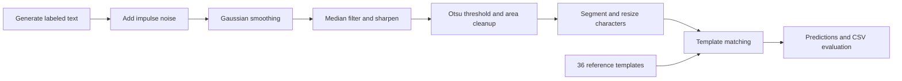

# CAPTCHA Recognition Pipeline

**From noisy pixels to character predictions using classical computer vision.**


A notebook-based OCR pipeline that generates synthetic CAPTCHAs, reduces noise, isolates characters, and recognizes them against a reference alphabet. It connects image-processing techniques into an inspectable workflow, with intermediate visualizations and per-character results exported to CSV. Recognition uses **template matching**, with no model training.

| Input | Recognition | Saved result |
| :--- | :--- | :--- |
| Four-character synthetic CAPTCHAs | 36 templates: `a–z`, `0–9` | **90.13% character accuracy** — 484 / 537 saved segments |

[Workflow](#-how-it-works) · [Results](#-results-and-evaluation) · [Run locally](#-run-locally) · [Engineering takeaways](#-engineering-takeaways)

## 🎯 Purpose

This computer-vision coursework project explores how much of a text-recognition task can be solved with filtering, connected components, and image similarity. The [assignment brief](Descriptions.pdf) asks for a complete non-learning OCR workflow: generate noisy text images, preprocess them, segment individual characters, and evaluate recognition.

The scope is deliberately controlled: lowercase letters and digits rendered on a plain background. It provides a practical setting for studying how preprocessing and segmentation affect downstream recognition.

## ✨ Highlights

- **Synthetic data generation:** 200 × 100 images containing four random characters, filename-based labels, and salt-and-pepper noise with a configured probability of 0.03.
- **Multi-stage preprocessing:** Gaussian smoothing, median filtering, a custom sharpening kernel, Otsu binarization, and small-component removal.
- **Ordered character extraction:** 8-connected component analysis, left-to-right bounding-box sorting, and normalization to 64 × 64 pixels.
- **Transparent recognition:** normalized correlation against 36 bundled reference images, retaining the best label and similarity score.
- **Inspectable outputs:** notebook comparison grids, segmentation counts, and a CSV linking each prediction to its source segment.

## 🔎 How it works



| Stage | Implementation |
| :--- | :--- |
| Generate | Pillow draws centered text; Python and NumPy supply random characters and noise. The default batch contains 20 images. |
| Clean | Gaussian blur uses radius `0.7`; a `3 × 3` median filter and sharpening kernel follow. Otsu thresholding separates foreground from background, and components smaller than **45 pixels** are discarded. |
| Segment | Connected components provide bounding boxes, sorted by horizontal position. Crops are resized with nearest-neighbor interpolation to preserve binary pixel values. |
| Recognize | Segment polarity is inverted to match the references. OpenCV's `TM_CCOEFF_NORMED` selects the highest-scoring template. |
| Evaluate | Ground truth is recovered from segment filenames; pandas exports `segment_file`, `predicted_label`, and `Metric`. |

**A few bundled reference templates** — these are matching targets, not prediction examples:

<p>
  
  
  
  
</p>

See the [notebook](codes/code.ipynb) for saved clean/noisy/filtered comparisons, preprocessing grids, and character-segmentation figures.

## 📊 Results and evaluation

The [committed CSV](codes/output_csv/final_results.csv) independently supports the notebook's printed **90.13%** result:

| Measure | Value |
| :--- | ---: |
| Saved character predictions | 537 |
| Correct predictions, checked against filename labels | 484 |
| Incorrect predictions | 53 |
| Character-level accuracy | 90.13% |
| Distinct source filename groups | 136 |

**Evaluation scope matters.** The saved results exceed the default 20-image batch. Output folders are reused without clearing, so repeated execution can accumulate files; the exact run history is not recorded. Treat this as accuracy over the committed segments, not a reproducible single-batch benchmark or full-CAPTCHA accuracy. Missing segments are not counted as errors by this metric.

The most frequent saved confusions are `i → j` (11), `c → o` (10), and `j → 1` (10). These provide concrete targets for improving preprocessing and shape matching, although the CSV alone does not establish their causes. `Metric` is a **correlation score**, not a calibrated probability.

## 🧰 Technology stack

| Tool | Role |
| :--- | :--- |
| Python · Jupyter Notebook | Four sequential implementation stages, written explanations, and saved outputs |
| Pillow · NumPy | Text rendering, image arrays, synthetic noise, and filter kernels |
| OpenCV | Filtering, thresholding, connected components, resizing, and template matching |
| Matplotlib | Visual inspection of intermediate images and segmentation |
| pandas | Structured prediction export |
| gdown | Fallback template download if `Mapset` is absent; templates are already included |

## ⚙️ Run locally

You need Python, pip, and an available TrueType font. Dependencies are not version-pinned in this repository.

**1. From the repository root, create an environment and install dependencies.**

```bash
python -m venv .venv
```

Activate it with `.venv\Scripts\Activate.ps1` in Windows PowerShell, or `source .venv/bin/activate` on macOS/Linux, then run:

```bash
python -m pip install jupyterlab pillow numpy opencv-python matplotlib pandas gdown
cd codes
python -m jupyterlab code.ipynb
```

**2. Set `FONT_PATH` in the first code cell.**

The notebook currently points to `/usr/share/fonts/truetype/msttcorefonts/Arial.ttf`. Replace it with the path to an installed font, for example `r"C:\Windows\Fonts\arial.ttf"` on Windows if present. Using a different font can change recognition results.

**3. Run the notebook cells in order, with `codes/` as the working directory.**

The notebook creates `captchas_raw/`, `captchas_noisy/`, `captchas_filtered/`, `captchas_preprocessed/`, and `captchas_segmented/`, then writes `output_csv/final_results.csv`. **Running recognition overwrites the saved CSV**; copy it first if you want to retain the committed reference result.

For a fresh experiment, move any previous generated `captchas_*` directories out of `codes/` before running all cells. The generation step is unseeded, and later stages can process stale files, so rerunning cells in place will not reproduce the saved result. A clean default batch starts with 20 CAPTCHAs and 80 intended character positions; extracted segment counts can differ.

## 🗂️ Repository guide

```text
.
├── README.md
├── Descriptions.pdf              # Original assignment brief (Persian)
└── codes/
    ├── code.ipynb                # Implementation, reports, and saved figures
    ├── Mapset/                   # 36 reference images, each 64 × 64
    └── output_csv/
        └── final_results.csv    # Saved per-character predictions and scores
```

Generated CAPTCHA images and individual segments are not committed; visual examples are embedded in the notebook.

## 💡 Engineering takeaways

The implementation demonstrates practical image-array processing, staged OCR design, visual debugging, and filename-based evaluation. Its design choices also expose useful trade-offs:

| Challenge | Approach and lesson illustrated |
| :--- | :--- |
| Suppressing noise while retaining character shape | Median filtering and sharpening follow Gaussian smoothing. Sharpening enhances edges; it does not perform inverse deblurring. |
| Separating noise from meaningful small features | Area-based filtering removes small components, but a fixed threshold can also discard dots or thin character parts. |
| Comparing differently sized character crops | Nearest-neighbor resizing standardizes dimensions, though stretching crops can alter aspect ratios. |
| Preserving reading order | Sorting bounding boxes by x-coordinate reconstructs left-to-right order; connected components still assume separable character shapes. |
| Measuring the right outcome | Segment accuracy is easy to inspect, but complete-string accuracy and segmentation failures need separate evaluation. |

## 🚀 Possible next steps

- Seed both random generators, isolate each run's outputs, and pin dependencies for repeatable experiments.
- Add segmentation-count checks, full-CAPTCHA exact-match accuracy, and confusion-matrix reporting.
- Compare aspect-ratio-preserving padding, component grouping for dotted characters, and alternative area thresholds.
- Evaluate multiple fonts and noise levels on a fixed benchmark, and add a rejection threshold for weak matches.
